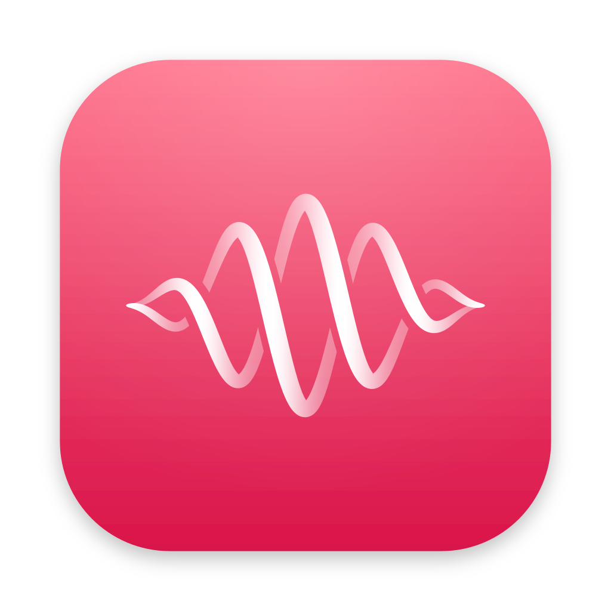
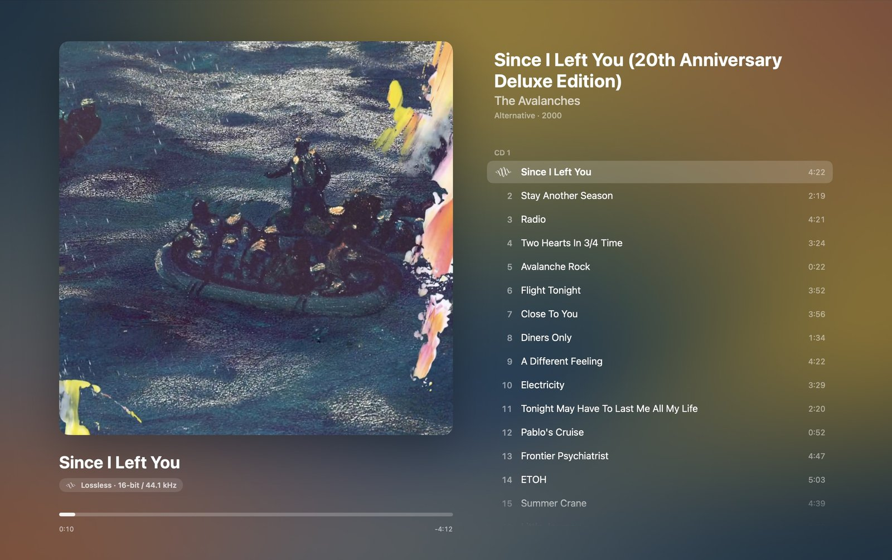
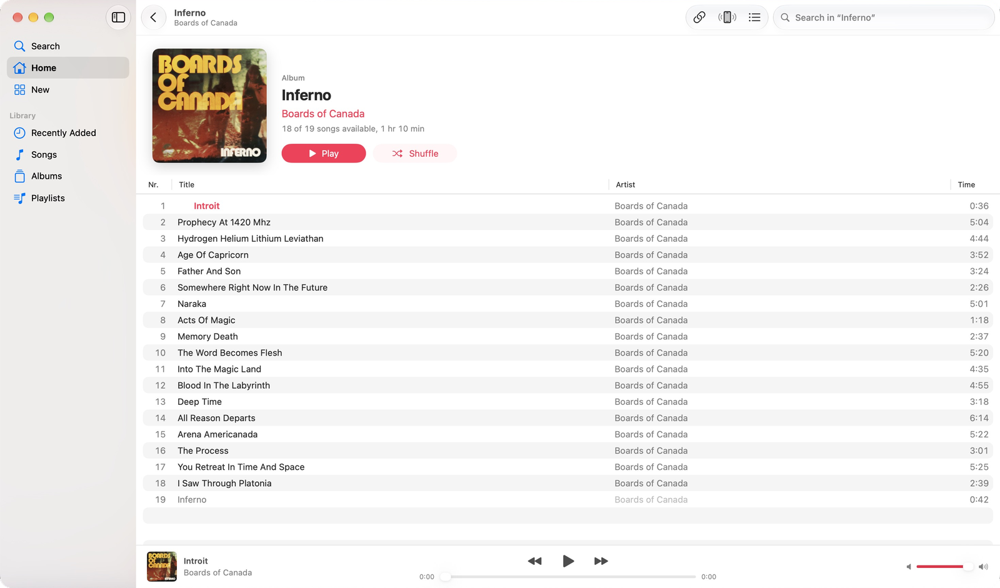
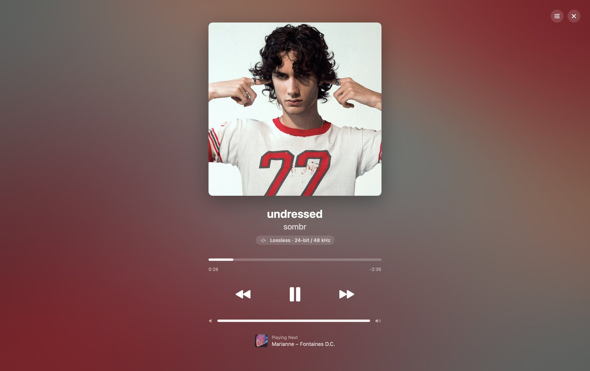
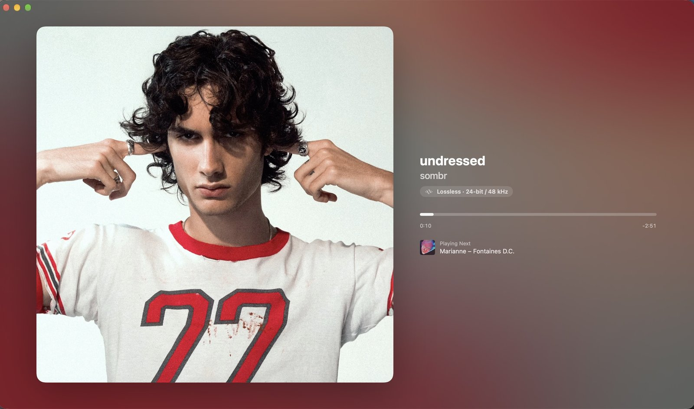
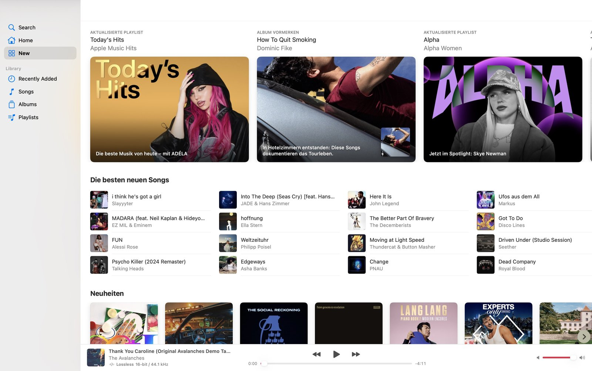

<p align="center">
  
</p>

<h1 align="center">Helix</h1>

<p align="center">
  A native macOS player for your own Apple Music subscription, with lossless
  (ALAC) playback, a Music-app-style library and catalog browser, a phone
  remote and an AirPlay receiver. Runs on Intel and Apple Silicon, macOS 15 or later.
</p>

<p align="center">
  <a href="https://github.com/rubbelgeorge/helix/releases/latest"><b>Download</b></a> ·
  <a href="#requirements-bring-your-own-wrapper">Setup</a> ·
  <a href="#screenshots">Screenshots</a>
</p>

<p align="center">
  <a href="https://ko-fi.com/rubbishgee"></a>
</p>

<p align="center">
  
</p>

> **Not affiliated with Apple.** Apple Music is a trademark of Apple Inc.
> Helix contains no Apple code, no keys and no wrapper. It only plays
> audio for a subscription you hold; it cannot download, save or export
> titles. Use it in accordance with the terms of your Apple Music subscription
> and the law of your country.

## Screenshots

<p align="center">
  
  <br><em>Album pages with lossless playback, like the Music app</em>
</p>

<table>
  <tr>
    <td width="50%"></td>
    <td width="50%"></td>
  </tr>
  <tr>
    <td align="center"><em>Full-screen player</em></td>
    <td align="center"><em>Alternative layout with the cover on the left</em></td>
  </tr>
</table>

<p align="center">
  
  <br><em>Apple's editorial “New” page</em>
</p>

## Requirements: bring your own wrapper

Helix does not handle Apple's licensing itself. It talks to a
[wrapper-v2](https://github.com/glomatico/wrapper-v2) instance that **you**
build and run, for example with Docker on the same Mac or on a machine in your
local network. wrapper-v2 ships no Apple code either; see its README for what
it needs and how to build it. You sign in to Apple Music in Helix, which
passes the sign-in to your wrapper.

On first launch Helix asks for the wrapper's address:

| Field | Default (wrapper-v2 Compose) |
|---|---|
| Address | `127.0.0.1` |
| HTTP port | `80` |
| Decrypt port | `10020` |

Change it later in **Settings › Wrapper**. Plain HTTP is only allowed to local
addresses (loopback, private IPs, `.local`). wrapper-v2 has no authentication,
so expose it only inside a network you trust.

**Prefetch key.** Apple encrypts the first seconds of every track with a
shared prefetch key that wrapper-v2 leaves to the client. Helix does not
include it; enter it once under **Settings › Wrapper › Start of Songs**
(32 hexadecimal characters). Without it the start of a track cannot be played.

**Performance.** The wrapper is contacted once per ~15-second segment.
On the same Mac or over wired LAN this is not noticeable; over Wi-Fi start
and seeking are slightly slower. Hi-Res needs about 5 Mbit/s in each direction.

## Using the app

The window follows the Music app: **Home** (personal recommendations),
**New** (Apple's editorial page), **Search** (⌘F; catalog search and
browse categories), artist pages and the library (**Recently Added**,
**Songs**, **Albums**, **Playlists**) with a sortable track table and a player
bar. Toolbar: song link (⌘L), remote popover with QR code, **Playing Next**
queue (⌥⌘U) and search.

- **Controls** menu: Space play/pause, ⌘→/⌘← next/previous, ⌥⌘→/⌥⌘← 15 s,
  ⌘↑/⌘↓ volume, ⌘1–3 sections, ⌘R reload, ⌘[ back. Media keys, Control Center
  and the Dock menu work too. Closing the window keeps music playing; quit with ⌘Q.
- Full-screen player (click the cover or ⇧⌘F, Esc closes) with two layouts,
  adjustable text and cover size, animated covers where Apple offers them, and
  an album view while an album plays in order.
- Playback is gapless; the next title is prepared ~20 s before the end.
- The output device is switched to the track's sample rate when it supports
  it (Settings › Playback) and restored when playback stops.

Some pages (New, browse categories, artist banners, animated covers) use
undocumented Apple endpoints and may change without notice.

## How playback works

The player picks the best stereo ALAC rendition and downloads the encrypted
segments directly from Apple's CDN. Only the encrypted sample data is sent to
your wrapper's decrypt port (wrapper-v2's batch protocol); the returned
samples are decoded by macOS in memory. Decrypted audio is never written to
disk, and the app has no export or download function.

## Remote

Open the address shown in the app on a phone in the same network or scan the
QR code. Every device in the local network may control playback; public
addresses and requests from other websites are refused. Source: `Remote/`
(React, Vite, Tailwind); run `npm ci && npm run build` before packaging.

## AirPlay receiver

Settings › **AirPlay** enables a bundled [Shairport Sync](https://github.com/mikebrady/shairport-sync)
receiver (classic AirPlay 1, not AirPlay 2 or multiroom), advertised as
**Helix – <Mac name>**. Metadata and covers appear in the app and remote
when the sender provides them. It works without the wrapper.

## Build

Requires Xcode and Node.js.

```sh
(cd Remote && npm ci && npm run build)
python3 tools/build-airplay.py        # clones Shairport Sync at a pinned commit
python3 tools/build-client.py         # universal app in build/Helix.app
python3 tools/build-client.py --arch x86_64 --output 'build/Intel/Helix.app' --zip
node tools/make-icon.mjs              # only when the icon changes (needs rsvg-convert)
```

`build-airplay.py` pins Shairport Sync 5.5.1
(`01078ad15d4da06dffba0c5f15ffeaf9146a2a2a`) and checksum-pinned build
dependencies (libconfig, popt, OpenSSL, a minimal FFmpeg ALAC decoder), linked
statically. Its licenses are bundled with the helper. Every release also
ships `Helix-<version>-airplay-sources.tar` with the exact sources and patch of
the helper (FFmpeg and libconfig are LGPL 2.1); do the same when you
redistribute your own build.

## Checks

- `Tests/WrapperProbe.swift`: against a running, signed-in wrapper, fetches a
  track, decrypts segments over the decrypt port and decodes them in memory.
- `Tests/MediaProbe.swift`: sample reconstruction and in-memory decoding
  against a clear reference segment (fixtures are not part of the repository).
- `Tests/LibraryProbe.swift`: library paging and catalog mapping.
- `Tests/AirPlayProbe.swift`, `Tests/AirPlayReceiverProbe.py`: receiver parsing
  and a loopback session.
- `client/DevSnapshots.swift` (only with `-D SNAPSHOT`) and `build/dev/snap.sh`
  write PNGs of the app's own window for UI review.

All probes print counts only, never tokens or media.

## License

MIT, see [LICENSE](LICENSE). The bundled AirPlay helper (Shairport Sync and its
dependencies) keeps its own licenses, included with the helper in the app.

## Support

If you enjoy Helix, you can buy me a coffee:

[](https://ko-fi.com/rubbishgee)
